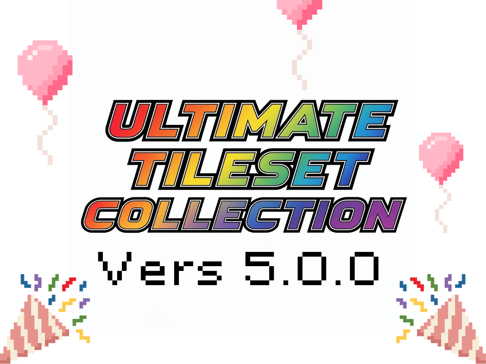

# Pokémon Ultimate Tileset Collection

**An unofficial readability fork of the [original Pokémon Ultimate Tileset Collection Google Sheet](https://docs.google.com/spreadsheets/d/1hy3DqFFUu_H6Ddibr5evoqGW8aVSPHxSH6cZWuu9IR8/edit?gid=0#gid=0).**

> **Original catalogue and source of truth:** [Pokémon Ultimate Tileset Collection — Google Sheets](https://docs.google.com/spreadsheets/d/1hy3DqFFUu_H6Ddibr5evoqGW8aVSPHxSH6cZWuu9IR8/edit?gid=0#gid=0).
>
> This repository is **just a fork / reorganisation for easier browsing, reading, searching and finding tilesets**. It is not the original spreadsheet, its official continuation, or a claim of authorship over the compilation or any artist's work. For original context, changes and corrections, please consult the spreadsheet and each creator's artwork page.

## Browse the collection

### **[Open the tileset catalogue →](https://mcmanussliam.github.io/pokemon-ultimate-tileset-collection/)**

A simple white catalogue written in TypeScript. Search by title or artist; filter by category, subcategory and generation; switch between list and grid views; open the original artwork or its index folder.

Gallery deployment is handled by [GitHub Actions](.github/workflows/sync-catalog.yml). If the gallery URL is not yet active, select **Settings → Pages → Build and deployment → Source: GitHub Actions**, then rerun the workflow.

## Browse the collection on GitHub

**711 listings from 7 sheets**, grouped into primary categories and their original subcategories:

| Spreadsheet category | Tilesets |
| --- | ---: |
| [Outdoor Tilesets](outdoor-tilesets/) | 382 |
| [Indoor Tilesets](indoor-tilesets/) | 90 |
| [Indoor + Outdoor Tilesets](indoor-outdoor-tilesets/) | 28 |
| [Misc Tilesets](misc-tilesets/) | 80 |
| [Animated Tilesets](animated-tilesets/) | 62 |
| [Auto Tilesets](auto-tilesets/) | 14 |
| [Mixed Collections](in-out-misc-etc/) | 55 |

The original spreadsheet's primary-category column determines the subfolder (e.g. buildings, trees, paths, water or general where no category was supplied).

~~~text
outdoor-tilesets/
  beaches/
    beach-and-sea-tiles-peekychew/
      README.md        # Creator, link, credits, and preview if available
      metadata.json    # Structured, machine-readable metadata
      tileset.png      # Only when the creator permits redistribution
_catalog/
  catalog.json         # Source for the TypeScript gallery
scripts/
  sync.ts              # Imports the Google Sheet and migrates folders safely
  thumbnails.ts        # Creates local WebP thumbnails of real artwork
site/
  src/
    main.ts            # Lightweight searchable gallery
    style.css
~~~

**Image previews:** Previews are generated locally by [`scripts/thumbnails.ts`](scripts/thumbnails.ts) using real artwork images, downscaled to small WebP files. They are not invented/generated pictures, and the gallery no longer hotlinks remote images. The resolver tries existing tileset files first, then authorised image URL overrides, then publicly accessible source-page images. If an image cannot be fetched, the entry shows **Image unavailable**. Creators can request preview removal via [_catalog/preview-exclusions.json](_catalog/preview-exclusions.json) or a GitHub issue. The repository does not automatically redistribute full-resolution tilesets.

## Attribution and usage

- The original spreadsheet describes tilesets as **non-commercial**. Always verify the actual terms with the creator.
- Credit individual artists where required; spreadsheet symbols such as ☆ indicate artist credit is required. An unspecified credit requirement is **not** a blanket licence.
- **Non-commercial use does not necessarily allow rehosting an image.** This collection never grants a new licence to someone else's artwork.
- If you own an image and would like its preview or listing removed, open an issue. Broken attribution and credits can also be corrected there.

This is a browsing index. Pokémon and related marks are the property of their respective owners. Individual fan-made artwork belongs to its creators.

## Tooling and updates

Node.js 22 or newer:

~~~sh
npm install
npm run sync                  # Read original Google Sheet, update folders/metadata
npm run thumbnails -- --limit=250 # Resolve and save local WebP thumbnails
npm run check                 # TypeScript type check
npm run build                 # Static gallery to dist/
~~~

The workflow in [.github/workflows/sync-catalog.yml](.github/workflows/sync-catalog.yml) syncs the spreadsheet and builds/deploys the gallery on pushes to main, and can also be run manually. Imports preserve hand-edited README files and non-generated media when migrating paths.

**Original spreadsheet:** https://docs.google.com/spreadsheets/d/1hy3DqFFUu_H6Ddibr5evoqGW8aVSPHxSH6cZWuu9IR8/edit?gid=0#gid=0
